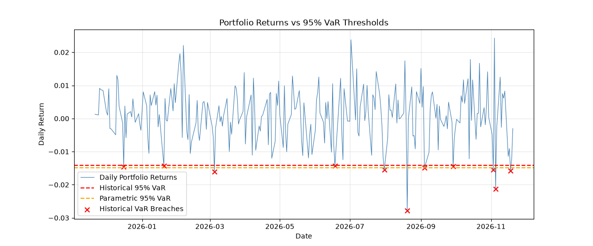
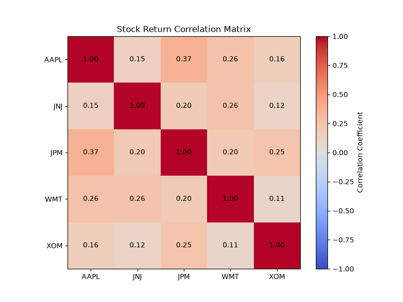
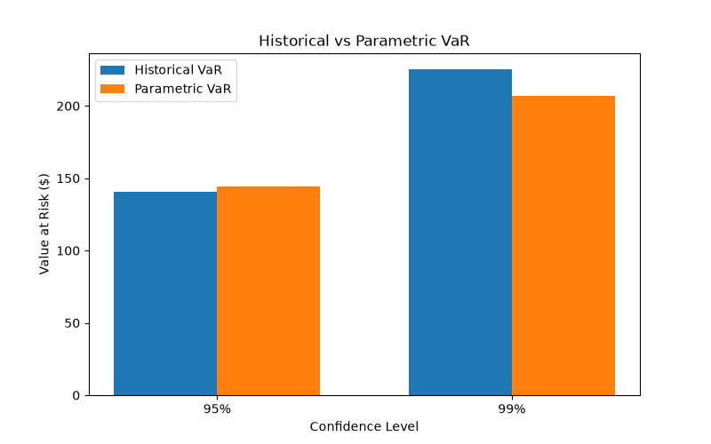
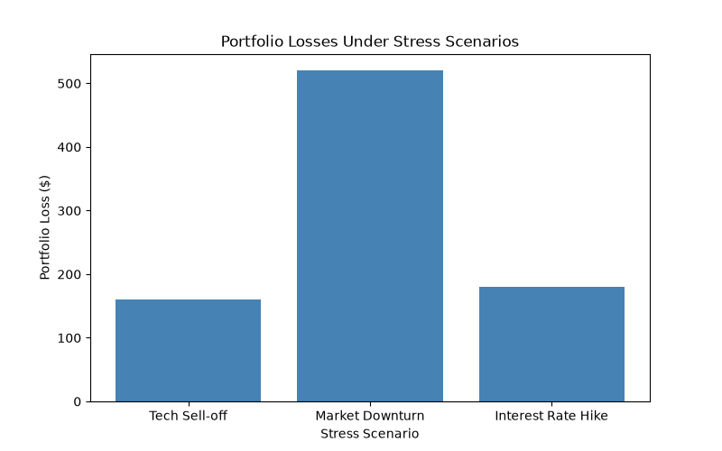

# Portfolio-Risk-Analysis-Model

A Python-based portfolio risk analysis project that evaluates the risk characteristics of an equally weighted equity portfolio using historical market data.

The model implements portfolio volatility, correlation analysis, market beta, Value at Risk (VaR), Expected Shortfall (ES), stress testing and out-of-sample VaR backtesting.

## 1. Project Overview

This project aims to apply quantitative risk management techniques to a hypothetical investment portfolio, examining potential losses under normal and stressed market conditions.

The analysis focuses on three questions:

- How much risk does the portfolio carry?
- How large could potential daily losses be?
- How well do the estimated risk thresholds perform against unseen historical data?

## 2. Portfolio and Data

The portfolio consists of five equally weighted US equities:

| Ticker | Company | Weight |
|---|---|---:|
| AAPL | Apple | 20% |
| JPM | JPMorgan Chase | 20% |
| JNJ | Johnson & Johnson | 20% |
| XOM | Exxon Mobil | 20% |
| WMT | Walmart | 20% |

- **Initial hypothetical portfolio value:** $10,000
- **Data source:** Yahoo Finance (`yfinance`)
- **Historical period:** Approximately five years
- **Frequency:** Daily adjusted closing prices
- **Portfolio construction:** Constant 20% weights for each asset

## 3. Risk Measures

The model implements:

- **Portfolio Volatility:** Measures fluctuations in daily portfolio returns using asset covariances and portfolio weights.
- **Correlation Analysis:** Examines relationships between individual equity returns and potential diversification benefits.
- **Market Beta:** Estimates the sensitivity of individual equities and the overall portfolio to movements in the S&P 500.
- **Historical VaR:** Estimates 95% and 99% daily loss thresholds using historical portfolio returns.
- **Parametric VaR:** Estimates daily loss thresholds under a normal distribution assumption.
- **Expected Shortfall:** Calculates the average loss on days when losses exceed the historical VaR threshold.

## 4. Stress Testing

Three hypothetical scenarios are applied to evaluate portfolio sensitivity to adverse market movements:

1. Technology sector sell-off
2. Broad market downturn
3. Interest rate increase

Each scenario applies assumed asset-level percentage shocks to estimate the corresponding portfolio return and dollar loss.

## 5. VaR Backtesting

Historical and parametric VaR estimates are evaluated using an 80/20 chronological training-testing split.

The model compares observed daily losses against fixed VaR thresholds estimated from the training sample and calculates breach frequencies at the 95% and 99% confidence levels.

## 6. Selected Results

| Risk Measure | 95% | 99% |
|---|---:|---:|
| Historical VaR | 1.4071% | 2.2513% |
| Parametric VaR | 1.4427% | 2.0708% |
| Historical Expected Shortfall | 2.0100% | 3.0960% |

### Stress-Test Results

| Scenario | Portfolio Return | Estimated P&L |
|---|---:|---:|
| Technology sell-off | -1.60% | -$160 |
| Broad market downturn | -5.20% | -$520 |
| Interest rate increase | -1.80% | -$180 |

### Backtesting Breach Rates

| Confidence Level | Expected | Historical VaR | Parametric VaR |
|---|---:|---:|---:|
| 95% | 5.00% | 4.38% | 2.79% |
| 99% | 1.00% | 0.40% | 0.40% |

Results are illustrative and depend on the data retrieval date.

## 7. Visualisations

The model generates four visualisations to illustrate portfolio risk characteristics, compare risk estimates and assess potential losses under adverse market conditions.

### 7.1 VaR Backtesting

The chart compares out-of-sample daily portfolio returns against the historical and parametric 95% VaR thresholds. Historical VaR breaches are highlighted to identify days when realised losses exceeded the estimated threshold.



### 7.2 Correlation Heatmap

The heatmap displays pairwise correlations between the five equities, illustrating relationships between individual asset returns and potential diversification benefits.



### 7.3 Historical vs Parametric VaR

The bar chart compares historical and parametric VaR estimates at the 95% and 99% confidence levels, expressed as potential daily losses in US dollars for the hypothetical $10,000 portfolio.



### 7.4 Stress Testing

The bar chart illustrates estimated portfolio losses under three hypothetical scenarios: a technology sector sell-off, a broad market downturn and an interest rate increase.



## 8. Technologies Used

- Python
- pandas
- NumPy
- yfinance
- Matplotlib

## 9. Running the Project

Install the required libraries:

```bash
pip install -r requirements.txt
```

Run the model:

```bash
python main.py
```

An internet connection is required to download market data.

## 10. Limitations and Future Improvements

The model is subject to historical data dependence, changing asset correlations, distributional assumptions and a limited backtesting period.

Potential extensions include rolling VaR estimation, portfolio optimisation, risk contribution analysis and a broader multi-asset portfolio.

## 11. Documentation

For a detailed explanation of the calculations, assumptions and limitations, see the [Methodology Document](methodology.pdf).
